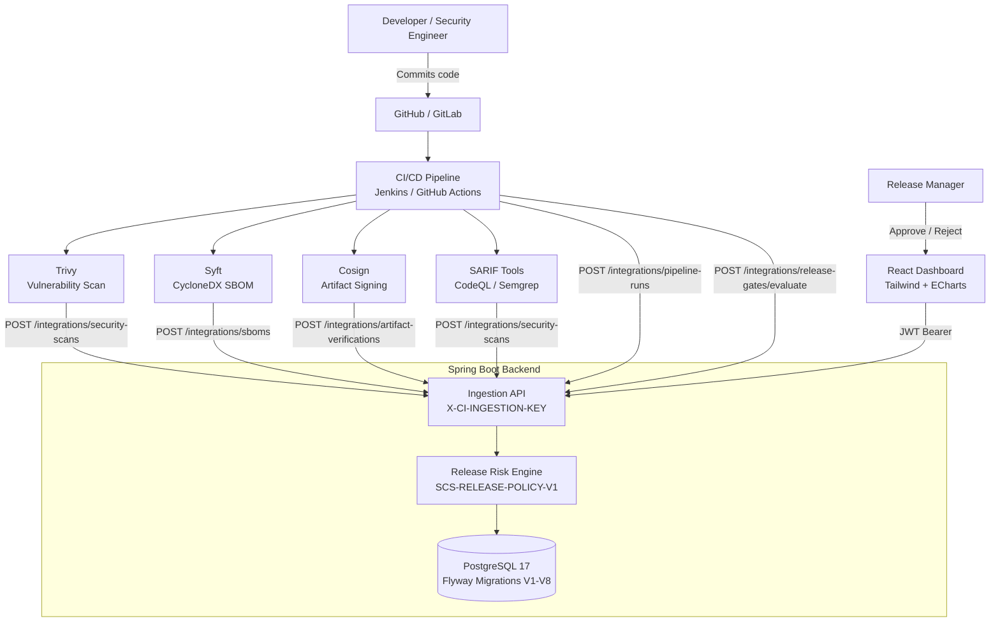

# SupplyChain Sentinel
### Software Supply Chain Risk & Release Assurance Platform

[](https://adoptium.net/)
[](https://spring.io/projects/spring-boot)
[](https://react.dev/)
[](https://www.typescriptlang.org/)
[](https://www.postgresql.org/)
[](https://docs.docker.com/compose/)
[](https://docs.github.com/en/actions)
[](https://aws.amazon.com/eks/)
[](https://www.terraform.io/)
[](https://owasp.org/www-project-devsecops-guideline/)

---

SupplyChain Sentinel is a **portfolio-grade DevSecOps platform** that centralizes software supply-chain security evidence and enforces release assurance gates across the software development lifecycle.

It collects CI/CD pipeline metadata, normalizes security scanner results, manages SBOMs, tracks artifact integrity, and produces deterministic, explainable release-risk decisions — giving security engineers and release managers a single place to understand whether a software artifact is safe to ship.

**Why it exists:** Modern engineering teams run Trivy, Gitleaks, SonarQube, Syft, and Cosign in parallel, but the results land in separate dashboards. SupplyChain Sentinel ingests all that evidence, correlates it with a specific pipeline run and artifact digest, and answers a clear question: should this release proceed?

---

## Project Overview

### The Problem

Organizations integrate multiple security scanners into CI/CD pipelines, but the evidence is fragmented:

- Vulnerability reports live in Trivy or OWASP Dependency-Check
- SBOM documents are generated but never tracked across builds
- Artifact signatures are verified in CI but the result is never recorded centrally
- Release approvals happen in chat or spreadsheets with no audit trail
- There is no single source of truth linking a specific pipeline run to its security posture

### What SupplyChain Sentinel Provides

| Capability | What it does |
|---|---|
| Application Inventory | Register applications with criticality, ownership, hosting environment |
| Pipeline Tracking | Ingest build metadata from Jenkins and GitHub Actions |
| Security Findings | Normalize Trivy and SARIF results, deduplicate across scans |
| SBOM Management | Store Syft-generated CycloneDX 1.7 documents and component inventory |
| Artifact Integrity | Record CI-reported Cosign verification results with digest association |
| Release Assurance | Deterministic PASS/WARN/BLOCK with approval workflow and audit trail |
| Executive Dashboard | Real-time metrics derived entirely from PostgreSQL |

### Who Uses It

- **Security Engineers** — triage findings, review scan coverage, manage SBOM inventory
- **Release Managers** — approve or reject releases based on risk evidence
- **Developers** — view pipeline history, findings, and release status for their applications
- **Auditors** — read-only access to findings, assessments, and audit history
- **CI/CD Pipelines** — submit evidence via the integration API using a pre-shared key

---

## Key Features

### Application Management
- Register applications with name, key, business unit, owner, and criticality
- Track hosting environment (AWS, Azure, GCP, On-Premises, Hybrid)
- Flag internet-facing applications for risk-score weighting
- Manage lifecycle status (Planning, Active, Deprecated, Retired)
- Data classification labelling (Public, Internal, Confidential, Restricted)

### CI/CD Integration
- Jenkins and GitHub Actions pipeline metadata ingestion
- Idempotent ingestion — repeated submissions update records, never create duplicates
- Artifact SHA-256 digest tracking through the full build cycle
- Pipeline status lifecycle: QUEUED → RUNNING → SUCCESS/FAILED/CANCELLED
- Support for both providers through a single ingestion endpoint

### Security Findings
- **Trivy JSON** ingestion (container, filesystem, repository scans)
- **SARIF 2.1.0** ingestion (CodeQL, Semgrep, ESLint, and others)
- Finding normalization — consistent severity levels across all scanners
- Deterministic fingerprinting — same vulnerability in the same application produces one record
- Triage lifecycle: OPEN → ACKNOWLEDGED → IN_PROGRESS → REMEDIATED → ACCEPTED
- Historical scan-to-finding traceability (which scans detected which findings)
- Findings preserved across repeated scans; triage status never overwritten by re-scans

### SBOM Management
- CycloneDX JSON 1.7 (primary) and 1.6 (compatibility) support
- Designed for **Syft**-generated SBOMs
- Document SHA-256 calculated server-side (caller-provided hash never trusted)
- Normalized component inventory with name, version, PURL, CPE, licenses, hashes
- Component search by name or PURL
- Historical SBOM storage — all versions retained per pipeline run
- SBOM associated with application, pipeline run, and artifact digest

### Artifact Integrity
- Records **CI-reported Cosign verification evidence**
- KEY mode (trusted public key) and KEYLESS mode (OIDC issuer + signer identity)
- Immutable artifact references required (must contain `@sha256:`)
- Verification status: VERIFIED, FAILED, MISSING_SIGNATURE, ERROR
- Full history retained — each verification attempt is a separate record

> **Important:** The backend stores verification results reported by your CI pipeline. It does not independently perform cryptographic signature verification. Verification happens in your CI environment using the `cosign verify` command; the result is then submitted to SupplyChain Sentinel.

### Release Assurance
- Deterministic scoring policy: **SCS-RELEASE-POLICY-V1** (no AI, no LLMs)
- PASS / WARN / BLOCK decisions with full explanation
- Mandatory hard-block conditions (missing SBOM, failed Cosign, active CRITICAL vulns, etc.)
- Approval workflow with separation of duties (requester cannot approve own release)
- CI release gate endpoint for automated pipeline integration
- Immutable assessment records — reassessments create new records
- Complete audit trail for every action

---

## Architecture



### Planned AWS Deployment Architecture

```
React (dist/) ──► S3 Private Bucket ──► CloudFront OAC ──► Users

Spring Boot JAR ──► Docker Image ──► Docker Hub ──► Amazon EKS (pods)
                                                          │
                                                          ▼
                                                  Amazon RDS PostgreSQL
                                                  (private subnets)

AWS Secrets Manager ──► EKS secrets injection
Terraform             ──► Infrastructure provisioning
GitHub Actions        ──► CI/CD and deployment
```

The AWS architecture is the **intended production deployment target**. It is designed and documented but not currently provisioned. The application is fully containerized and environment-variable-driven for this deployment.

---

## Technology Stack

### Frontend
| Technology | Version | Purpose |
|---|---|---|
| React | 19 | UI component library |
| Vite | 6 | Build tool and dev server |
| TypeScript | 5.7 | Static typing |
| Tailwind CSS | 3.4 | Utility-first styling |
| Apache ECharts | 5.5 | Dashboard charts and visualizations |
| React Router | 7 | Client-side routing |
| Axios | 1.7 | HTTP client with token refresh interceptor |

### Backend
| Technology | Version | Purpose |
|---|---|---|
| Java | 21 | Runtime |
| Spring Boot | 3.5 | Application framework |
| Spring Security | 6.5 | Authentication, RBAC, stateless JWT |
| Spring Data JPA | 3.5 | ORM and repository layer |
| Hibernate | 6.6 | JPA implementation |
| JJWT | 0.12 | JWT access and refresh token management |
| Flyway | 11.7 | Append-only schema migrations |
| springdoc-openapi | 2.6 | Swagger UI and OpenAPI spec |
| Jackson | 2.18 | JSON serialization |

### Database
| Technology | Purpose |
|---|---|
| PostgreSQL 17 | Primary data store with JSONB, TIMESTAMPTZ, UUID |

### Security Tools (CI integration)
| Tool | Purpose |
|---|---|
| Trivy | Container and filesystem vulnerability scanning |
| Syft | CycloneDX SBOM generation |
| Cosign | Artifact signing and verification |
| SARIF-compatible tools | CodeQL, Semgrep, ESLint — static analysis |
| Gitleaks | Secret scanning (documented, ingestion via SARIF) |

### Containerization
| Technology | Purpose |
|---|---|
| Docker | Backend and frontend containerization |
| Docker Compose | Local full-stack orchestration |
| Nginx | Frontend static file server and API proxy |

### Planned Infrastructure
| Technology | Purpose |
|---|---|
| Amazon EKS | Backend Kubernetes deployment |
| Amazon RDS | Managed PostgreSQL |
| Amazon S3 + CloudFront | Frontend static hosting with OAC |
| AWS Secrets Manager | Runtime secret injection |
| Terraform | Infrastructure provisioning |
| GitHub Actions | CI/CD and deployment pipelines |

---

## Eight-Phase Project Roadmap

| Phase | Description | Status |
|---|---|---|
| 1 | Project Foundation — Spring Boot + React + PostgreSQL + Docker Compose | ✅ Complete |
| 2 | Authentication, JWT and RBAC — Five roles, refresh-token rotation, BCrypt | ✅ Complete |
| 3 | Application Inventory — Full CRUD, search, filtering, pagination | ✅ Complete |
| 4 | Executive Dashboard — Database-derived KPIs and ECharts visualizations | ✅ Complete |
| 5 | CI/CD Integration — Jenkins + GitHub Actions pipeline ingestion | ✅ Complete |
| 6 | Security Findings — Trivy/SARIF ingestion, deduplication, scan traceability | ✅ Complete |
| 7 | SBOM and Artifact Integrity — Syft/CycloneDX SBOM, Cosign evidence | ✅ Implemented |
| 8 | Release Assurance — Risk scoring, release gates, approvals, audit trail | ✅ Implemented |

---

## Screenshots

No screenshots have been captured yet. To document the UI:

1. Run the application locally (see [Quick Start](#quick-start)).
2. Navigate to each section of the dashboard.
3. Save screenshots to `docs/screenshots/`.
4. Reference them here using ``.

Suggested captures:
- `docs/screenshots/dashboard-overview.png` — Executive dashboard with KPI cards and charts
- `docs/screenshots/application-inventory.png` — Application list with criticality badges
- `docs/screenshots/pipeline-runs.png` — CI/CD pipeline history
- `docs/screenshots/security-findings.png` — Findings table with severity filter
- `docs/screenshots/sbom-management.png` — SBOM list and component inventory modal
- `docs/screenshots/artifact-verifications.png` — Cosign verification history
- `docs/screenshots/release-assessment.png` — PASS/WARN/BLOCK decision with evidence
- `docs/screenshots/release-detail.png` — Full evidence breakdown and approval history

---

## Quick Start

### Prerequisites

- [Docker Desktop](https://www.docker.com/products/docker-desktop/) (includes Docker Compose)
- Git

### Method 1 — Docker Compose (Recommended)

```bash
# 1. Clone the repository
git clone <repository-url>
cd kiro_ai

# 2. Configure environment variables
cp .env.example .env
```

Open `.env` and set the following — the defaults work locally but **must** be changed for any shared environment:

```
DB_PASSWORD=your-strong-database-password
```

The Compose file also reads these from the environment or `.env` (see [Environment Variables](#environment-variables)):

```
JWT_SECRET       — minimum 32 characters, required
INITIAL_ADMIN_USERNAME  — admin username on first startup
INITIAL_ADMIN_PASSWORD  — admin password on first startup
INITIAL_ADMIN_EMAIL     — admin email on first startup
```

```bash
# 3. Validate the Compose configuration
docker compose config -q

# 4. Build and start all services
docker compose up --build -d

# 5. Check service status
docker compose ps

# 6. Follow logs
docker compose logs -f

# 7. Access the application
```

| Service | URL |
|---|---|
| Frontend | http://localhost:3000 |
| Backend API | http://localhost:8080 |
| Swagger UI | http://localhost:8080/swagger-ui.html |
| Health check | http://localhost:8080/actuator/health |
| PostgreSQL | localhost:5432 |

```bash
# 8. Verify backend health
curl http://localhost:8080/actuator/health
curl http://localhost:8080/api/v1/ping

# 9. Stop all services (data is preserved in named volumes)
docker compose down
```

> ⚠️ **Do not run `docker compose down -v`** in a development environment unless you intend to delete all application data. The `-v` flag removes named Docker volumes including the PostgreSQL data volume (`pgdata`).

See the [Docker Compose reference](https://docs.docker.com/reference/cli/docker/compose/) for all options.

---

### Method 2 — Local Development (without Docker)

See **[docs/local-setup.md](docs/local-setup.md)** for the complete guide.

Quick overview:

```bash
# Backend (from /backend)
cp .env.example .env       # edit with your database credentials and JWT secret
set -a && source .env && set +a   # Git Bash: load .env into environment
./mvnw clean package       # compile and package
./run.sh                   # loads .env and starts the JAR

# Frontend (separate terminal, from /frontend)
npm ci
npm run dev                # starts Vite dev server at http://localhost:5173
```

---

## Environment Variables

### Root `.env` (Docker Compose)

| Variable | Default in Compose | Description |
|---|---|---|
| `DB_NAME` | `supplychain_sentinel` | PostgreSQL database name |
| `DB_USERNAME` | `scsentinel` | PostgreSQL username |
| `DB_PASSWORD` | `scsentinel` | PostgreSQL password — **change this** |

### Backend `.env` (local development)

| Variable | Required | Description |
|---|---|---|
| `SPRING_PROFILES_ACTIVE` | No | `dev` (default), `docker`, `prod` |
| `DB_HOST` | Yes | PostgreSQL host (`localhost` for local) |
| `DB_PORT` | Yes | PostgreSQL port (default `5432`) |
| `DB_NAME` | Yes | Database name |
| `DB_USERNAME` | Yes | Database username |
| `DB_PASSWORD` | Yes | Database password |
| `JWT_SECRET` | **Yes** | HMAC-SHA256 key — minimum 32 bytes |
| `JWT_ISSUER` | No | JWT issuer claim (default `supplychain-sentinel`) |
| `JWT_ACCESS_TOKEN_TTL_MINUTES` | No | Access token lifetime (default `15`) |
| `JWT_REFRESH_TOKEN_TTL_DAYS` | No | Refresh token lifetime (default `7`) |
| `APP_COOKIE_SECURE` | No | Set `true` for HTTPS deployments |
| `APP_MAX_LOGIN_ATTEMPTS` | No | Brute-force threshold (default `5`) |
| `APP_CORS_ALLOWED_ORIGINS` | No | Comma-separated frontend origins |
| `CI_INGESTION_API_KEY` | **Yes** | Integration key — minimum 32 bytes |
| `INITIAL_ADMIN_USERNAME` | No | Admin username on first startup |
| `INITIAL_ADMIN_PASSWORD` | No | Admin password on first startup |
| `INITIAL_ADMIN_EMAIL` | No | Admin email on first startup |

### Frontend `.env` (local development)

| Variable | Default | Description |
|---|---|---|
| `VITE_API_BASE_URL` | `/api/v1` | Backend API base URL (Vite proxies in dev) |

---

## Initial Administrator Setup

On the first startup, if `INITIAL_ADMIN_USERNAME`, `INITIAL_ADMIN_PASSWORD`, and `INITIAL_ADMIN_EMAIL` are all set, the backend automatically provisions an administrator account. This only runs once — if a user with that username already exists, it is skipped.

**For Docker Compose:** Set these in `.env` before running `docker compose up`.

**For local development:** Set them in `backend/.env` or export them before starting the backend.

After first login, change the admin password through the Administration section in the UI. Do not leave default credentials in place in any shared or internet-accessible environment.

The admin provisioning runner is skipped in the `test` Spring profile to allow test isolation.

---

## Application Usage Workflow

A typical end-to-end workflow:

1. **Log in** using the provisioned admin account at http://localhost:3000.
2. **Register an application** — Applications → Register Application. Set criticality, owners, hosting environment.
3. **Review the dashboard** — the Overview page shows real-time metrics from the database.
4. **Configure CI/CD** — add the `CI_INGESTION_API_KEY` as a secret in Jenkins or GitHub Actions.
5. **Execute a pipeline** — the CI workflow submits pipeline metadata, security scans, SBOM, and Cosign verification via the ingestion API.
6. **Review findings** — Security Findings page shows normalized, deduplicated vulnerabilities from Trivy/SARIF.
7. **Inspect the SBOM** — SBOM Management shows component inventory with version, PURL and license data.
8. **Check artifact integrity** — Artifact Integrity page shows the CI-reported Cosign verification result.
9. **Create a release assessment** — Release Management → New Assessment. The risk engine evaluates all evidence.
10. **Review the PASS/WARN/BLOCK decision** — the assessment detail shows risk score, score breakdown, hard-block reasons, and evidence snapshot.
11. **Approve or reject** — Release Managers and Admins can approve PASS/WARN assessments. BLOCK assessments require new evidence and a new assessment.
12. **Inspect the audit trail** — every action (assessment creation, approval, CI gate evaluation) is recorded in an append-only audit log visible on the assessment detail page.

---

## RBAC

Permissions are enforced in the Spring Security layer, not just the UI.

| Action | ADMIN | SECURITY_ENGINEER | DEVELOPER | RELEASE_MANAGER | AUDITOR |
|---|:---:|:---:|:---:|:---:|:---:|
| Register application | ✓ | ✓ | — | — | — |
| Edit application | ✓ | ✓ | — | — | — |
| Delete application | ✓ | — | — | — | — |
| View applications | ✓ | ✓ | ✓ | ✓ | ✓ |
| Create user | ✓ | — | — | — | — |
| View users | ✓ | ✓ | ✓ | ✓ | ✓ |
| View pipeline runs | ✓ | ✓ | ✓ | ✓ | ✓ |
| View security findings | ✓ | ✓ | ✓ | ✓ | ✓ |
| Update finding status | ✓ | ✓ | — | — | — |
| View SBOMs | ✓ | ✓ | ✓ | ✓ | ✓ |
| View artifact verifications | ✓ | ✓ | ✓ | ✓ | ✓ |
| Create release assessment | ✓ | ✓ | ✓ | ✓ | ✓ |
| View release assessments | ✓ | ✓ | ✓ | ✓ | ✓ |
| Approve / reject release | ✓ | — | — | ✓ | — |
| Approve own assessment | — | — | — | — | — |
| View dashboard | ✓ | ✓ | ✓ | ✓ | ✓ |

> Requester cannot approve their own release assessment regardless of role — separation of duties is enforced in the service layer.

---

## Release Risk Scoring

**Policy: `SCS-RELEASE-POLICY-V1`**

All scoring is deterministic integer arithmetic. No AI or machine learning is used.

### Score Formula

```
Risk Score = min(
    criticality_points
  + internet_exposure_points
  + vulnerability_points,
  100
)
```

### Application Criticality

| Criticality | Points |
|---|---:|
| CRITICAL | 20 |
| HIGH | 15 |
| MEDIUM | 10 |
| LOW | 5 |

Internet-facing adds **+10 points**.

### Vulnerability Points (OPEN and ACKNOWLEDGED findings only)

| Severity | Points per finding |
|---|---:|
| CRITICAL | 30 |
| HIGH | 15 |
| MEDIUM | 5 |
| LOW | 1 |
| INFO / UNKNOWN | 0 |

REMEDIATED findings contribute 0. ACCEPTED findings are reported separately in the evidence snapshot and do not contribute to the score.

### Decision Thresholds

| Score | Decision |
|---|---|
| 0 – 24 | **PASS** |
| 25 – 49 | **WARN** |
| 50 – 100 | **BLOCK** |

### Hard-Block Conditions

These return **BLOCK** regardless of the numerical score:

1. Pipeline execution status is not `SUCCESS`
2. Artifact SHA-256 digest is missing from the pipeline run
3. No SBOM document exists for the exact application + pipeline run + digest
4. No successful Cosign verification record exists for the exact artifact digest
5. No security scan exists for the corresponding pipeline run
6. At least one CRITICAL vulnerability finding is OPEN or ACKNOWLEDGED

---

## Testing

### Backend

```bash
cd backend
./mvnw clean test
```

The test suite runs against a dedicated PostgreSQL database (`supplychain_sentinel_test`). Each test class uses `@Transactional` for automatic rollback. The latest run reports **184 tests, 0 failures**.

| Test Class | Tests | Coverage |
|---|---|---|
| `ReleaseAssessmentIntegrationTest` | 32 | Scoring, hard gates, approvals, CI gate, audit |
| `SbomIntegrationTest` | 34 | CycloneDX ingestion, components, verification, dedup |
| `ApplicationIntegrationTest` | 26 | CRUD, search, filters, RBAC |
| `AuthIntegrationTest` | 23 | JWT, refresh rotation, RBAC enforcement |
| `SecurityFindingIntegrationTest` | 21 | Trivy/SARIF ingestion, dedup, status updates |
| `DashboardIntegrationTest` | 13 | Metric accuracy across all modules |
| `PipelineRunIntegrationTest` | 19 | Ingestion, idempotency, filtering |
| `ScanTraceabilityIntegrationTest` | 7 | Scan-to-finding junction table |
| `IngestionKeyFilterTest` | 7 | API key validation, 503 misconfiguration |
| `HealthControllerTest` | 1 | Health endpoint |
| `SupplyChainSentinelApplicationTests` | 1 | Spring context loads with all modules |

### Frontend

```bash
cd frontend
npm run build
```

The build runs TypeScript type-checking followed by Vite production bundling. Latest result: **built in ~26s, 0 TypeScript errors**.

---

## CI/CD Integration Documentation

| Guide | Description |
|---|---|
| [Jenkins](docs/integrations/jenkins.md) | Complete Jenkinsfile with pipeline ingestion, Trivy, Syft, Cosign, and release gate |
| [GitHub Actions](docs/integrations/github-actions.md) | Complete workflow YAML with the same coverage |
| [Trivy](docs/integrations/trivy.md) | Generating and submitting Trivy JSON vulnerability reports |
| [SARIF](docs/integrations/sarif.md) | Submitting SARIF reports from CodeQL, Semgrep, and other tools |
| [Syft](docs/integrations/syft.md) | Generating CycloneDX SBOMs and submitting them |
| [Cosign](docs/integrations/cosign.md) | Artifact signing, verification, and submitting CI-reported evidence |

---

## API Documentation

| Resource | URL (local) |
|---|---|
| Swagger UI | http://localhost:8080/swagger-ui.html |
| OpenAPI JSON | http://localhost:8080/api-docs |

### Endpoint Categories

| Category | Base path | Auth |
|---|---|---|
| Authentication | `/api/v1/auth` | Public (login, refresh) / JWT |
| User Management | `/api/v1/users` | JWT |
| Application Inventory | `/api/v1/applications` | JWT |
| CI/CD Pipelines | `/api/v1/pipeline-runs` | JWT |
| Security Findings | `/api/v1/security-findings` | JWT |
| SBOM Documents | `/api/v1/sboms` | JWT |
| Artifact Verifications | `/api/v1/artifact-verifications` | JWT |
| Release Assessments | `/api/v1/release-assessments` | JWT |
| Dashboard | `/api/v1/dashboard` | JWT |
| Ingestion (pipeline) | `/api/v1/integrations/pipeline-runs` | `X-CI-INGESTION-KEY` |
| Ingestion (scan) | `/api/v1/integrations/security-scans` | `X-CI-INGESTION-KEY` |
| Ingestion (SBOM) | `/api/v1/integrations/sboms` | `X-CI-INGESTION-KEY` |
| Ingestion (verification) | `/api/v1/integrations/artifact-verifications` | `X-CI-INGESTION-KEY` |
| Release gate (CI) | `/api/v1/integrations/release-gates/evaluate` | `X-CI-INGESTION-KEY` |
| Health | `/api/v1/ping`, `/actuator/health` | Public |

**JWT Authentication:** Pass an access token as `Authorization: Bearer <token>`. Tokens expire after 15 minutes (configurable). The frontend uses an in-memory token store and automatically refreshes via the HttpOnly refresh-token cookie.

**Integration API Key:** CI systems pass the key in `X-CI-INGESTION-KEY`. Keys must be at least 32 bytes. A missing or too-short server-side key returns HTTP 503; an incorrect client key returns 401.

---

## Known Limitations

1. **Cosign TUF transparency log** — Local blob signing and verification were confirmed working (`Verified OK` / `invalid signature` for tampered content). Keyless OIDC verification and Sigstore transparency-log entries require network access to `tuf-repo-cdn.sigstore.dev`, which was unreachable during final validation. The backend API supports and validates KEYLESS verification records submitted by CI pipelines that do have network access.

2. **Live CI pipeline execution** — Jenkins and GitHub Actions integration examples are documented and designed against the tested API contract. They were not executed against live CI infrastructure.

3. **AWS infrastructure** — The application is fully containerized, stateless, and environment-variable-driven for AWS deployment. Terraform infrastructure and EKS deployment are designed but not provisioned.

4. **Frontend bundle size** — The ECharts charting library adds ~1.4 MB to the JavaScript bundle (472 KB gzip). Code-splitting is a future improvement.

5. **Docker Compose PostgreSQL** — The Compose configuration uses a named volume (`pgdata`). The `docker compose down` command does not remove volumes; `docker compose down -v` does. Do not run the `-v` variant without understanding the data implications.

---

## Future Deployment Architecture

The application is designed for this AWS deployment:

```
GitHub Actions
    │
    ├── Build backend Docker image ──► Docker Hub ──► Amazon EKS (pods)
    │                                                        │
    └── Build frontend static files ──► Amazon S3 ──► CloudFront OAC ──► Users
                                                             │
                                                    Amazon RDS PostgreSQL
                                                    (private subnet)
                                                             │
                                                    AWS Secrets Manager
                                                    (JWT secret, DB password,
                                                     ingestion API key)
```

Infrastructure will be defined in Terraform. The application is stateless, uses environment-variable injection for all secrets, and has health endpoints suitable for EKS liveness and readiness probes.

---

## Database Schema

Managed by Flyway — migrations are append-only and never modified after application.

| Migration | Description |
|---|---|
| V1 | Users, roles, user_roles — 5 RBAC roles seeded |
| V2 | Auth schema — refresh_tokens, login tracking |
| V3 | Application inventory |
| V4 | Pipeline runs |
| V4.1 | FK constraint change (CASCADE → RESTRICT) |
| V5 | Security findings and scan records |
| V6 | Scan-to-finding junction table |
| V7 | SBOM documents, components, artifact verifications |
| V8 | Release assessments, approvals, audit events |

---

## Project Structure

```
kiro_ai/
├── docker-compose.yml          # Full-stack orchestration
├── .env.example                # Root env vars for Docker Compose
├── .gitignore
├── README.md
├── backend/
│   ├── pom.xml
│   ├── Dockerfile              # Multi-stage: Maven build → JRE 21 runtime
│   ├── mvnw / mvnw.cmd         # Maven wrapper — no global Maven needed
│   ├── run.sh                  # Local dev: loads .env and starts JAR
│   ├── .env.example
│   └── src/
│       ├── main/
│       │   ├── java/com/supplychainsentinel/
│       │   │   ├── config/         # CORS, OpenAPI, admin provisioning
│       │   │   ├── controller/     # 11 REST controllers
│       │   │   ├── dto/            # Request/response records
│       │   │   ├── entity/         # 14 JPA entities
│       │   │   ├── exception/      # Global exception handler
│       │   │   ├── mapper/         # Entity → DTO mappers
│       │   │   ├── repository/     # Spring Data JPA repositories
│       │   │   ├── security/       # JWT, filters, UserDetailsService
│       │   │   └── service/        # Business logic (risk engine, ingestion)
│       │   └── resources/
│       │       ├── application.yml
│       │       ├── application-dev.yml
│       │       ├── application-docker.yml
│       │       ├── application-prod.yml
│       │       └── db/migration/   # V1–V8 Flyway scripts
│       └── test/
│           └── java/               # 184 integration tests
├── frontend/
│   ├── package.json            # React 19, Vite 6, ECharts, Axios
│   ├── Dockerfile              # Multi-stage: Node build → Nginx serve
│   ├── nginx.conf              # SPA fallback + /api proxy
│   ├── .env.example
│   └── src/
│       ├── api/                # Typed Axios wrappers per module
│       ├── components/         # Shared UI (Modal, Pagination, etc.)
│       ├── context/            # AuthContext with in-memory token store
│       ├── layouts/            # MainLayout with sidebar
│       ├── pages/              # 14 page components
│       ├── routes/             # ProtectedRoute
│       └── types/              # Shared TypeScript interfaces
└── docs/
    ├── local-setup.md          # Detailed local development guide
    ├── api-documentation.md    # API endpoint reference
    └── integrations/
        ├── jenkins.md
        ├── github-actions.md
        ├── trivy.md
        ├── sarif.md
        ├── syft.md
        └── cosign.md
```

---

## What This Project Demonstrates

SupplyChain Sentinel is a portfolio project demonstrating practical **DevSecOps engineering** across the full stack:

- **Backend architecture** — Spring Boot 3.5, Spring Security, JWT with refresh-token rotation, JPA/Flyway, deterministic business logic
- **Security design** — RBAC with five roles, separation of duties, constant-time API key comparison, in-memory token storage, audit trail
- **CI/CD integration** — Real Trivy, Syft, and Cosign workflows with an ingestion API designed for Jenkins and GitHub Actions
- **Supply-chain security** — SBOM management, artifact integrity tracking, and release assurance gating
- **Frontend engineering** — React 19 with TypeScript, Tailwind CSS, ECharts, Axios with automatic token refresh, and role-based UI
- **DevOps practices** — Docker Compose, multi-stage Dockerfiles, Nginx proxying, Flyway migrations, health probes, graceful shutdown
- **Cloud readiness** — Stateless backend, externalized configuration, containerized deployment ready for EKS + RDS

---

*Built as a complete DevSecOps platform demonstrating real-world software supply-chain security engineering.*
